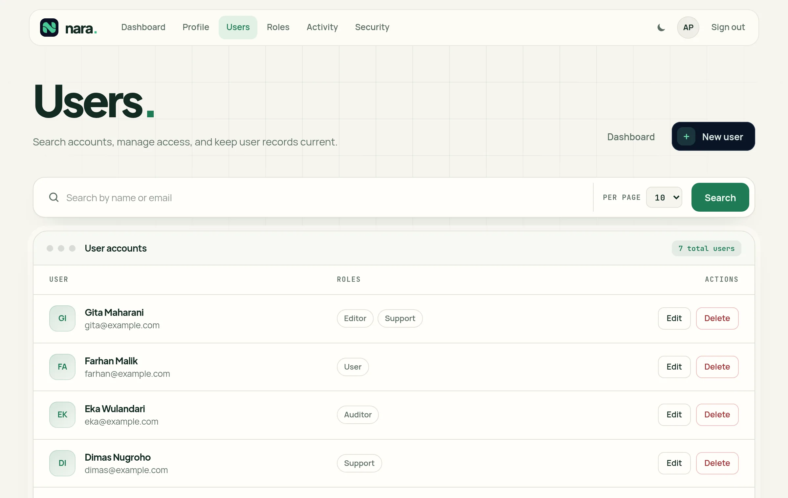
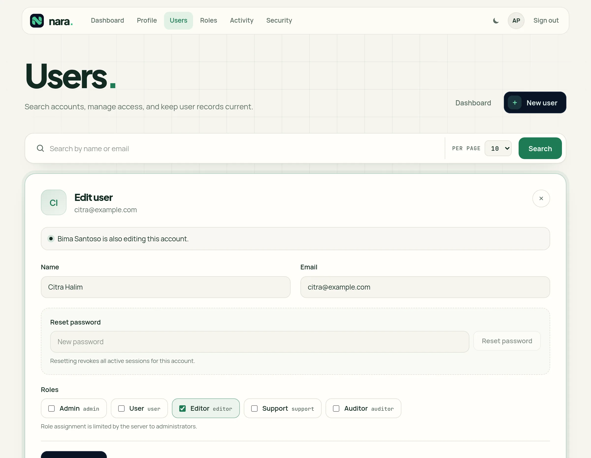
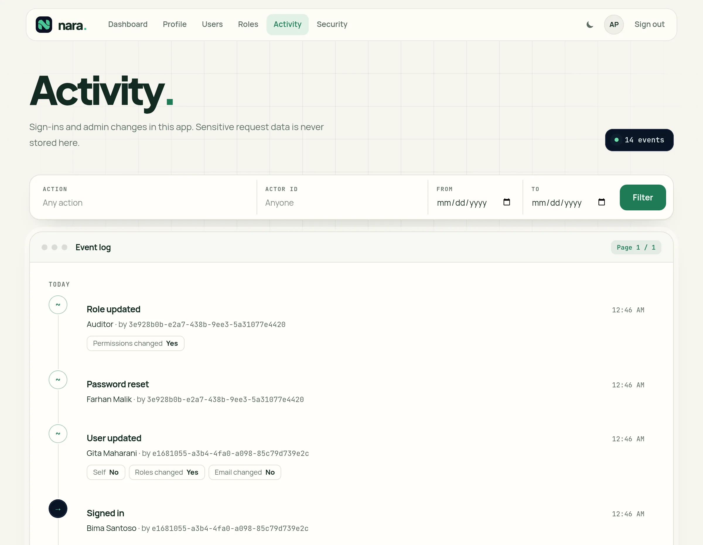
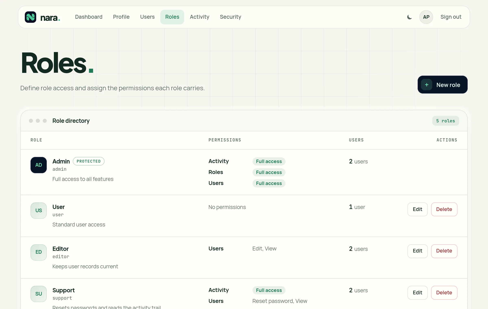
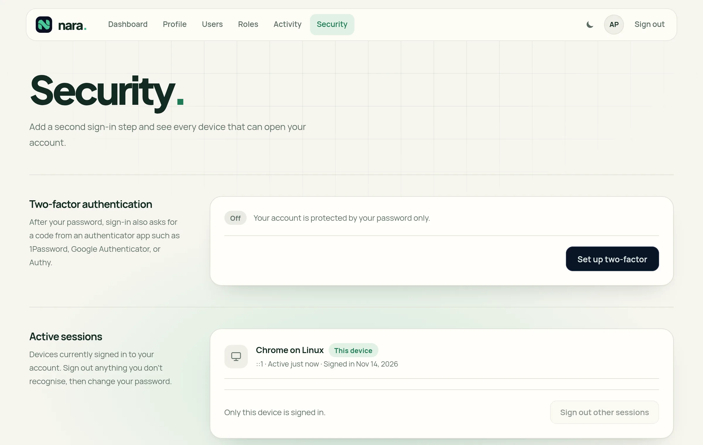

<div align="center">


# Nara

**Types catch wrong code. Nara catches wrong access.**

A full-stack TypeScript application you own as source: Hono, Vue and SQLite,
with sign-in, roles, users and an activity trail already built. Let AI write
your features. Nara proves who can reach every route and hear every event,
before it ships.

[Quick start](#quick-start) · [What's new](#whats-new-in-35) · [What you get](#what-you-get) · [Production](#production) · [Documentation](#documentation)

</div>

<picture>
  <source media="(prefers-color-scheme: dark)" srcset="docs/screenshots/users-dark.webp">
  
</picture>

## Why Nara

- **Every route declares its access.** The server refuses to start while an
  `/api` route declares none, and the authorization matrix tests every route
  against anonymous callers, members, permission holders, and administrators.
- **Every live event declares its audience.** The realtime matrix proves each
  topic reaches the people it names and nobody else.
- **Every feature keeps to its boundary.** Features meet only through their
  public `index.ts`; `nara doctor` refuses anything else, and host contracts
  are verified by conformance suites.

TypeScript, Hono, Vue, and SQLite, without a custom runtime in between. Build by
feature, own the source, and keep evolving official features in place.

## What's new in 3.5

- **Scheduled backups.** In production the application backs its database up
  every 24 hours into `database/backups/` and keeps the newest 7. A restart
  neither writes an extra backup nor postpones the next one.
- **Made for a reverse proxy.** `HOST=127.0.0.1` keeps the port off the
  network, and the application warns when it sees proxied requests while
  `TRUST_PROXY` is off, the setting that otherwise makes every visitor share
  one rate limit. [`docs/deployment.md`](./docs/deployment.md) is a new guide
  to production behind Caddy or nginx.
- **Room to use the app.** Each client gets 600 API requests per 15 minutes
  instead of 100, which a few busy pages could spend.
- **Installs on macOS and Windows.** The lockfile carries the native packages
  of every platform, and CI installs, builds and sets up on both.
- The menu stays inside a phone-wide screen, the dev server starts on pino
  10.4, and dependency updates close 12 security advisories.

Every release is listed in [`CHANGELOG.md`](./CHANGELOG.md).

## Quick start

Nara needs Node.js 22 or newer.

```bash
git clone https://github.com/MasRama/nara.git my-app
cd my-app
npm ci
cp .env.example .env
npm run setup
npm run dev
```

Open <http://localhost:5555> and sign in:

```text
admin@nara.local / admin12345
```

`npm run setup` applies pending migrations and reference seeds, and creates
that first administrator. The password is temporary: the application requires
it to be changed before normal use. Set `NARA_ADMIN_NAME`, `NARA_ADMIN_EMAIL`,
and `NARA_ADMIN_PASSWORD` before setup to provide your own credential instead.

Development uses one Vite HTTP server on `PORT` (default `5555`). Vite serves
the Vue app and HMR while Hono handles `/api`, `/health`, and `/ready` on the
same origin.

### Start your own product

The repository root is the canonical Nara application baseline. Start a new
product from a checkout or copy of it, remove its Git history if you want an
independent repository, and rename the package in `package.json`. Nara
intentionally does not generate a second, smaller starter shape.

```bash
npm run check
npm run nara -- doctor
npm run nara -- context auth --json
npm run nara -- inspect users --json
```

`npm run nara --` runs the CLI from this checkout, and keeps working after you
rename the package. Do not use `npx nara` before `@nara-web/cli` is published:
it resolves an unrelated npm package. Nara's architecture analysis is
deterministic and does not require an AI provider.

## What you get

<table>
  <tr>
    <td width="50%">
      <picture>
        <source media="(prefers-color-scheme: dark)" srcset="docs/screenshots/editing-dark.webp">
        
      </picture>
    </td>
    <td width="50%">
      <picture>
        <source media="(prefers-color-scheme: dark)" srcset="docs/screenshots/activity-dark.webp">
        
      </picture>
    </td>
  </tr>
  <tr>
    <td width="50%">
      <picture>
        <source media="(prefers-color-scheme: dark)" srcset="docs/screenshots/roles-dark.webp">
        
      </picture>
    </td>
    <td width="50%">
      <picture>
        <source media="(prefers-color-scheme: dark)" srcset="docs/screenshots/security-dark.webp">
        
      </picture>
    </td>
  </tr>
</table>

The repository root is a working application, not a template to fill in:

- **Sign-in and accounts.** Registration, sign-in, a session per device that
  you can end from `/security`, and TOTP two-factor sign-in with recovery
  codes.
- **Roles and permissions.** Each Feature declares the permissions it gates;
  roles combine them, and the pages hide what the server would refuse.
- **Users.** Search, create, edit, reset a password, delete, and avatars.
- **Activity.** A trail of sign-ins and administration changes. Each Feature
  declares the actions it reports and can report only those.
- **Live updates.** Without a reload, the app signs a tab out, applies
  permission changes, and refreshes Activity, sessions, roles, and users.
- **Safe concurrent editing.** An open form shows who else is editing, takes
  other people's saves into the fields you have not touched, and asks only
  about fields you both changed.
- **The ground under them.** The SQLite lifecycle (migrations, seeds, backups,
  integrity checks), asset storage, CSRF protection, rate limits, security
  headers, structured logs, and a light and a dark theme.

Additional official capabilities are installed explicitly with `nara add`.

## Core model

A Feature owns one business capability:

```text
src/features/billing/
├── contract.ts       # shared boundary types and schemas
├── index.ts          # public server/general boundary
├── server/           # runtime and persistence
├── web/              # optional browser surface
└── tests/            # feature tests
```

Cross-feature imports use the target Feature's public boundary:

```ts
import { getCurrentUser } from '@/features/auth';
```

Deep cross-feature imports such as `@/features/users/server/repository` are
invalid and detected by `nara doctor`.

See [`ARCHITECTURE.md`](./ARCHITECTURE.md) and
[`docs/feature-model.md`](./docs/feature-model.md) for the full ownership and
composition rules.

## CLI

Common commands:

```text
nara make feature <name>        Create the canonical Feature skeleton
nara add <feature>              Install an official open-code Feature
nara evolve <feature>           Evolve installed official source
nara doctor                     Validate current architecture
nara inspect <feature>          Show bounded Feature facts
nara context <feature>          Produce a focused architecture context pack
nara impact <feature>           Show structural dependents
nara diff --base main           Describe architecture change
nara guard --base origin/main   Fail on newly introduced architecture debt
```

All architecture commands support deterministic JSON where documented.

Full command and output semantics live in [`docs/cli.md`](./docs/cli.md).

## Official Features

The current installable catalog is intentionally small:

```text
auth
health
users
activity
```

There is one copy of each: the Feature in `src/features/<name>`, marked
official by its `.nara/` folder and shipped from there by
`npm run stage:package`. Tests that need this reference app rather than the
Feature alone live in its `tests/app/` and are not shipped.

Activity records what other Features report. `nara add activity` mounts its
page, API, permission and retention; the application then creates a reporter
with `createActivityRecorder(...)` from `src/app/bindings/activity.server.ts`
and hands it to the Features it wants recorded, as the reference app does for
Auth and Users in `src/app/server.ts`. Each of those Features declares the
actions it reports, with the label the feed shows, and can report only those.

Installation copies visible source into the application and composes explicit
application-owned bindings where needed. There is no runtime plugin registry or
DI container. Users is the substantial assembly proof and can bind to the
reference Auth capability or another compatible provider.

Package shape and prerequisites are documented in
[`docs/feature-format.md`](./docs/feature-format.md).

## Repository map

```text
src/
├── app/                 application composition
├── cli/                 CLI and architecture engine
├── features/
│   ├── activity/        official (has .nara/)
│   ├── auth/            official (has .nara/)
│   ├── health/          official (has .nara/)
│   └── users/           official (has .nara/)
└── shared/              business-neutral infrastructure

resources/               Vue/Vite application shell
scripts/                 setup, database, build, release helpers
tests/                   cross-cutting and integration tests
```

`web/` is optional inside a Feature. The supported browser stack is Vue 3 +
Vite + TypeScript; Hono is the HTTP layer; SQLite uses `better-sqlite3` and raw
SQL.

## Development and verification

Use the narrowest relevant test while iterating, then run the canonical gate
before handoff:

```bash
npm run lint
npm run check:frontend
npm run test:fast
npm run test:integration
npm run test:heavy
npm run architecture:doctor
npm run check
npm run build
```

`npm run check` is the canonical repository gate. Release/distribution work
uses:

```bash
npm run validate:release
npm run perf:sanity   # separate machine-sensitive sanity check
```

See [`CONTRIBUTING.md`](./CONTRIBUTING.md) for contribution workflow and
validation expectations.

## Production

A Nara application in production is one Node process and one SQLite file. It
serves the built Vue app and the Hono APIs from the same process:

```bash
cp .env.production.example .env.production
npm run build
npm start
```

Production requires an explicit public `APP_URL` and a local SQLite path.

- **Reverse proxy.** The application speaks plain HTTP and has no certificate
  setting: a reverse proxy such as Caddy holds the TLS certificate. Behind
  one, set `HOST=127.0.0.1` and `TRUST_PROXY=true`, or every visitor shares
  one rate limit and one sign-in lockout.
- **Backups.** The application backs the database up every 24 hours into
  `database/backups/` and keeps the newest 7 (`DB_BACKUP_INTERVAL_HOURS`,
  `DB_BACKUP_KEEP`, `DB_BACKUP_DIR`). Copy that directory off the host: a
  backup on the same disk does not survive losing the disk.
- **Storage.** SQLite files, WAL files, and backups must live on storage local
  to the application host; the default architecture is not intended for
  shared multi-host network filesystems.
- **Live updates.** They stream from `GET /api/events` in the same process.
  The response sends `X-Accel-Buffering: no` for nginx; other reverse proxies
  must not buffer `text/event-stream` responses, and their read timeout must
  exceed the 25-second heartbeat.
- **Upkeep.** Each Feature declares the upkeep of its own tables, and the
  runtime runs it after migrations and then on each task's interval: Auth
  deletes expired sessions hourly, Activity prunes events older than
  `ACTIVITY_RETENTION_DAYS` (default `365`) in bounded batches, Users removes
  the avatars of deleted accounts, and the app optimizes SQLite planner
  statistics. Set the retention to `0` only when indefinite Activity retention
  is intentional.

[`docs/deployment.md`](./docs/deployment.md) walks through a deployment with
Caddy, the first administrator, backups and updates.

### Database

Development starts from `.env.example`. The main lifecycle commands are:

```bash
npm run setup
npm run migrate
npm run seed
npm run db:check
npm run db:backup
```

Database ownership, migrations, seeds, backup, restore, and integrity behavior
are documented in [`docs/database-lifecycle.md`](./docs/database-lifecycle.md).

### Asset storage

Nara ships a provider-neutral `AssetStorage` capability as part of the
guaranteed substrate. The reference app binds Users to the local filesystem
adapter under `storage/`, so cloning the repository still works with no cloud
account or extra service.

Features store a logical `storage_key` in their own metadata and depend only on
the `AssetStorage` contract. The application binding chooses the provider. A
deployment can therefore replace the local adapter with S3/R2-compatible
storage without changing Users-owned upload, cleanup, or delivery workflows.
Browser Feature code may not import `shared/storage`; storage providers remain
server-only infrastructure.

## Package status

The npm package is `@nara-web/cli` and exposes the `nara` executable. The first
registry publication is still pending. The staged publishable package lives at
`packages/nara`; `npm run stage:package` and `npm pack` produce the artifact
used by release validation.

## Documentation

- [`ARCHITECTURE.md`](./ARCHITECTURE.md) — current architecture authority
- [`docs/feature-model.md`](./docs/feature-model.md) — Feature ownership and boundaries
- [`docs/feature-format.md`](./docs/feature-format.md) — installable Feature format
- [`docs/auth.md`](./docs/auth.md) — registration, roles, your own sign-in pages, limits
- [`docs/cli.md`](./docs/cli.md) — CLI reference
- [`docs/database-lifecycle.md`](./docs/database-lifecycle.md) — SQLite lifecycle
- [`docs/deployment.md`](./docs/deployment.md) — production behind Caddy or nginx, backups, updates
- [`SECURITY.md`](./SECURITY.md) — security model and reporting
- [`CONTRIBUTING.md`](./CONTRIBUTING.md) — contribution workflow, commit prefixes, releases
- [`CHANGELOG.md`](./CHANGELOG.md) — what changed in each release
- [`CODE_OF_CONDUCT.md`](./CODE_OF_CONDUCT.md) — community participation

## License

[MIT](./LICENSE) — Built by [MasRama](https://github.com/MasRama)
